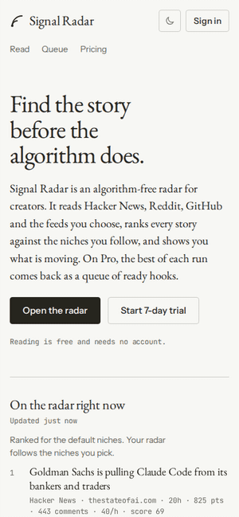

# Signal Radar

Signal Radar reads Hacker News, Reddit, GitHub and RSS feeds, ranks every story against the niches you follow, and shows
you what is moving. It has two tiers.

- **Free, no account.** The Read view. Stories are ranked by keyword match and momentum (points, stars and comments per
  hour). Your niches and sources live in localStorage and the ranking runs in the browser against a shared feed, so it
  costs nothing to serve.
- **Pro, sign-up.** The best of each run goes through an AI scorer tuned to your niches, which writes a hook, an angle
  and title options for each story. The results land in a personal Make queue where you pick or skip. Your picks and
  skips are fed back as examples on the next run. Pro also adds custom RSS feeds, a Telegram digest, Web Push, and an
  optional Notion sync. New accounts get a 7-day trial.



## How it works

1. `radar run` fetches every configured source once, deduplicates by URL and writes the result to the shared feed table.
2. Each item gets a keyword and momentum score. The free Read view is this ranking, and nothing more.
3. For each Pro user, the pipeline prefilters the shared feed by that user's niches and sends the top N to the AI
   provider (DeepSeek or Anthropic). Without a key the provider falls back to `none`: keyword ranking only.
4. Scored items are written to the user's queue. Items the user has already been shown are skipped.
5. If anything new was queued, the user gets a Telegram message and a Web Push notification, when they have set those up.

The scoring prompt includes the user's most recent picks and skips. Picked stories are the positive examples, skipped
ones the negative.

Custom feeds are user-supplied URLs, so the server fetches them defensively: http(s) only, no private, loopback,
link-local or metadata addresses, and the address check runs inside the socket's own DNS lookup, so a domain can't pass
the check and then rebind to an internal IP. Redirects are re-checked (max 3), with an 8 s timeout and a 2 MB cap.

## Stack

TypeScript throughout, on Node 24 with pnpm workspaces.

- `apps/web`: Vite, React 19, installable PWA (`vite-plugin-pwa`).
- `apps/api`: Hono, Better Auth (email and password, sessions in Postgres).
- `apps/cli`: the `radar` command. It is also what the cron job runs.
- `packages/core`: fetchers, ranking, scoring providers, Telegram, Web Push and Notion adapters.
- `packages/db`: Drizzle schema, migrations and the Postgres store.
- Postgres 18. Tests use vitest and a throwaway `radar_test` database.

## Local development

You need Node 24 (see `.nvmrc`), pnpm and Docker.

```sh
git clone https://github.com/sambit24795/signal-radar.git && cd signal-radar
pnpm install
cp .env.example .env     # set BETTER_AUTH_SECRET at least
pnpm db:up               # Postgres on :5432, also creates radar_test
pnpm db:migrate
pnpm api:dev             # API on http://localhost:8787
pnpm web:dev             # web on http://localhost:5173, proxies /api
pnpm radar run           # in another terminal: fetch, score, fill the queues
```

The web dev server proxies `/api` to the API, so run both. Sign up in the browser; you start on the trial and are Pro.
To fill that user's queue, run `pnpm radar run`. With no `DEEPSEEK_API_KEY` it uses the `none` provider, so you get
keyword-ranked items without hooks.

Payments are stubbed (`PAYMENTS_PROVIDER=stub`): the upgrade button on the Pricing page flips the account to Pro.
Lemon Squeezy is not wired up yet. In the meantime, `pnpm radar user:pro --email you@example.com` makes a user Pro from
the command line.

Checks:

```sh
pnpm lint
pnpm typecheck
pnpm test
pnpm web:build
```

## Configuration

Sources, default niches, the scoring provider and `topN` are in `radar.config.ts`. Everything else is environment
variables, read from `.env` by the API and the CLI.

| Variable                      | Purpose                                                                                                  |
| ----------------------------- | -------------------------------------------------------------------------------------------------------- |
| `TELEGRAM_BOT_TOKEN`          | Telegram bot token. Used for the per-user digest and for single-user `--local` mode.                     |
| `TELEGRAM_CHAT_ID`            | Chat that receives the digest in `radar run --local` mode.                                               |
| `DEEPSEEK_API_KEY`            | Enables the DeepSeek scorer. Missing: falls back to `none`.                                              |
| `NOTION_TOKEN`                | Notion integration token for `radar run --local`.                                                        |
| `DATABASE_URL`                | Postgres connection string. Required by the API and by `radar run`.                                      |
| `TEST_DATABASE_URL`           | Database the test suite resets and writes to. Keep it separate from `DATABASE_URL`.                      |
| `BETTER_AUTH_SECRET`          | Session signing secret, 32 characters or more.                                                           |
| `BETTER_AUTH_URL`             | Public base URL of the API.                                                                              |
| `WEB_ORIGIN`                  | Origin of the web app, for CORS and cookies. `http://localhost:5173` in dev.                             |
| `API_PORT`                    | Port the API listens on.                                                                                 |
| `LEMONSQUEEZY_WEBHOOK_SECRET` | Signing secret for the Lemon Squeezy webhook.                                                            |
| `VAPID_PUBLIC_KEY`            | Web Push public key. Generate a pair with `pnpm --filter @radar/core exec web-push generate-vapid-keys`. |
| `VAPID_PRIVATE_KEY`           | Web Push private key. With the other VAPID vars unset, push is disabled.                                 |
| `VAPID_SUBJECT`               | `mailto:` contact sent to push services.                                                                 |
| `TELEGRAM_BOT_USERNAME`       | Bot username without the `@`. Needed for the Connect Telegram link; unset hides the button.              |
| `TELEGRAM_WEBHOOK_SECRET`     | Secret the bot webhook must present. Unset: the webhook returns 404.                                     |

Also read, but not in `.env.example`: `ANTHROPIC_API_KEY` (when `provider: 'anthropic'`), `GITHUB_TOKEN` (higher GitHub
rate limit), `PAYMENTS_PROVIDER` (`stub` or `lemonsqueezy`, default `stub`) and `NOTION_DB_ID` (`--local` mode).

### Telegram connect

Create a bot with BotFather, then set `TELEGRAM_BOT_TOKEN`, `TELEGRAM_BOT_USERNAME` and a random
`TELEGRAM_WEBHOOK_SECRET`. Point the bot at your API, which must be reachable over HTTPS:

```sh
pnpm radar telegram:webhook https://api.example.com
```

Pro users can then connect their chat from Settings, Notifications.

## CLI

```
pnpm radar run                    fetch once, write the shared feed, queue items per Pro user
pnpm radar run --dry              print the ranked table, write nothing (no database needed)
pnpm radar run --local            single-user mode: data/seen.json, Notion and one Telegram chat
pnpm radar sources                list sources and their status
pnpm radar db:migrate             apply SQL migrations to DATABASE_URL
pnpm radar user:list              users with plan, status, trial end and niches
pnpm radar user:pro --email <e>   dev: make a user Pro
pnpm radar notion:init --parent <pageId>   create the Topic Queue database in Notion, print its id
pnpm radar telegram:webhook <publicBaseUrl>   point the bot at <base>/api/telegram/webhook
pnpm radar telegram:webhook --delete          remove the bot webhook
```

`run`, `run --dry` and `sources` accept `--config <file>`.

## Self-hosting

Nothing in it depends on a particular host: Postgres, a Node process for the API, static files for the web app, and
something to run `radar run` on a schedule (cron, a systemd timer, GitHub Actions). A single VPS with Docker works. Put a
reverse proxy in front that serves the built web app from `apps/web/dist` (with a fallback to `index.html` for client
routes) and forwards `/api` to the API. There is no Dockerfile in the repo yet; `docker-compose.yml` only runs Postgres
(and an optional RSSHub, `docker compose --profile rsshub up -d rsshub`).

The existing `.github/workflows/radar.yml` still targets the old single-user flow and needs updating before you rely on
it.

## Layout

```
apps/
  api/       Hono API: auth, feed, queue, settings, billing, push, Telegram webhook
  cli/       the radar command
  web/       Vite + React PWA
packages/
  core/      sources, ranking, scoring, digests, pipeline
  db/        Drizzle schema, migrations, Postgres store
radar.config.ts   sources, default niches, provider
docs/             build plans and the demo GIF
```

## License

[AGPL-3.0-only](LICENSE). If you run a modified version as a network service, you have to offer its source to its users.
